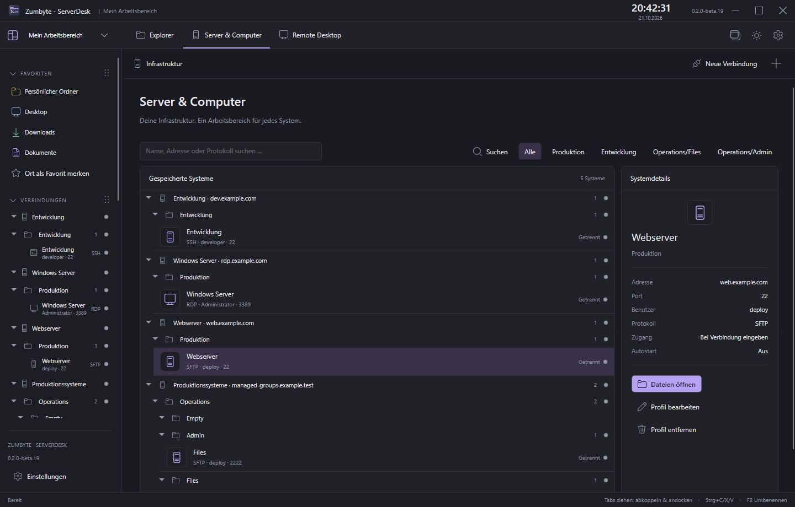
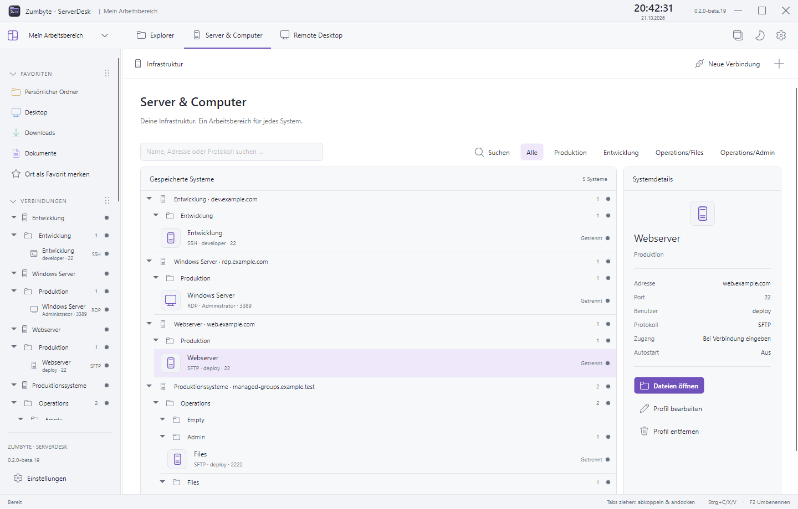
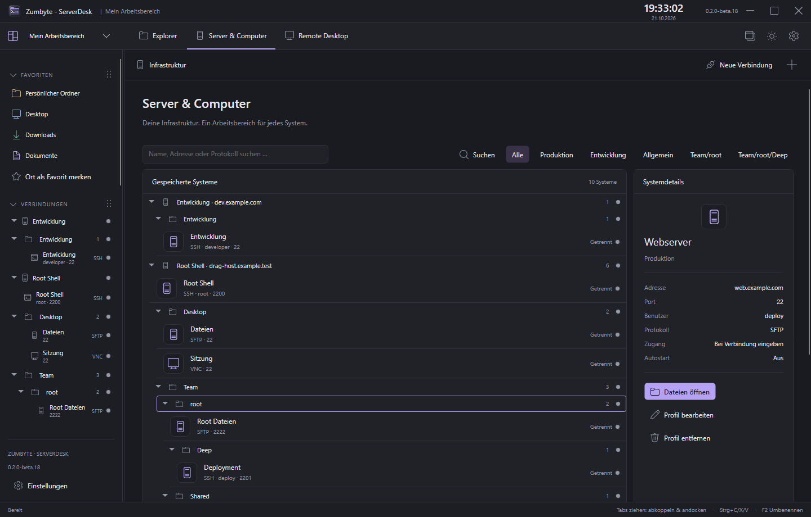
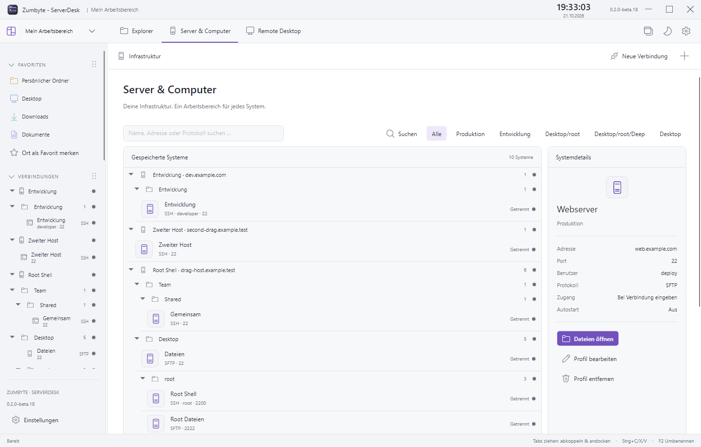

<h1 align="center">Zumbyte - ServerDesk</h1>

Dateien, Server und Cloudspeicher. Alles an einem Ort.

<a href="https://github.com/ZUMBYTE-AppSolution/serverdesk-release/releases">Herunterladen</a> · <a href="https://github.com/ZUMBYTE-AppSolution/serverdesk-release/wiki">Benutzerhandbuch</a> · <a href="https://www.zumbyte.de/support/">Support</a>

  

**Zumbyte - ServerDesk** ist dein zentraler Arbeitsplatz für lokale Dateien, Server, Remote-Desktops und Cloudspeicher. Die drei oberen Tabs **Explorer**, **Server & Computer** und **Remote Desktop** führen dich direkt zu deinen Aufgaben. Zwei Dateibereiche, flexible Dateitabs und ein integrierter Zugangstresor helfen dir, auch mit vielen Systemen den Überblick zu behalten. Ob Dateien übertragen, per SSH arbeiten oder Konfigurationen bearbeiten: Deine Werkzeuge bleiben zusammen.

Erhältlich als **Windows-x64-Beta** und für **macOS ab Version 14** auf Apple Silicon und Intel. Installer und vollständig enthaltene Laufzeiten machen den Einstieg einfach. Oberfläche auf Deutsch und Englisch, mit Dark und Light Mode.

| Dein Rechner | Passender Installer |
| --- | --- |
| Windows 10 / 11, x64 | [Windows-Installer](https://github.com/ZUMBYTE-AppSolution/serverdesk-release/releases/download/v0.2.0-beta.19/Zumbyte.ServerDesk-win-beta-Setup.exe) |
| Mac mit Apple-Chip (M1 und neuer) | [macOS Apple Silicon · arm64](https://github.com/ZUMBYTE-AppSolution/serverdesk-release/releases/download/v0.2.0-beta.19/Zumbyte.ServerDesk-osx-arm64-beta-Setup.pkg) |
| Mac mit Intel-Prozessor | [macOS Intel · x64](https://github.com/ZUMBYTE-AppSolution/serverdesk-release/releases/download/v0.2.0-beta.19/Zumbyte.ServerDesk-osx-x64-beta-Setup.pkg) |

Ab **Beta 12** sind Mac-App und Installer mit Developer ID signiert und von Apple notarisiert. Die Prüftickets sind den Downloads beigefügt. [Installation und Paketwahl](https://github.com/ZUMBYTE-AppSolution/serverdesk-release/wiki/Installation#macos).

## 🖼️ Einblicke

| Light Mode | Eigenständiger Editor |
| --- | --- |
|  |  |

| Server & Computer | Zugangstresor |
| --- | --- |
|  |  |

| Terminal | Auto-Lock |
| --- | --- |
|  |  |

| Cloudspeicher | Datenträger & Netzlaufwerke |
| --- | --- |
|  |  |

|  |  |
|  |  |

Die Screenshots zeigen ServerDesk mit Beispieldaten. Klicke auf ein Bild für die volle Auflösung.

Favoritenfarben persönlich gestalten

### Neu in Beta 19

- Hostgruppen, Hauptgruppen und Untergruppen bequem über das Kontextmenü erstellen, umbenennen und löschen – auch als leere Struktur für spätere Verbindungen.
- Ganze Zweige umbenennen und ihre Reihenfolge erhalten. Beim Löschen einer Gruppe bleiben alle Verbindungen und Zugangsdaten erhalten; die Profile erscheinen direkt unter dem Host.
- Gruppenstruktur und Anzeigenamen verschlüsselt je Arbeitsbereich speichern und zwischen Windows und Mac synchronisieren.

  
  

### Neu in Beta 18

- Verbindungen und ganze Untergruppen mit der Maus verschieben; Hosts, Gruppen und Verbindungen nach eigenen Wünschen anordnen.
- Einfügelinien, Aufklappen beim Darüberhalten und Scrollen am Rand unterstützen Drag-and-drop. Alternativ im Kontextmenü nach oben, nach unten oder nach Namen sortieren.
- Reihenfolge verschlüsselt je Arbeitsbereich speichern und zwischen Windows und Mac synchronisieren. Laufende Sitzungen bleiben bei reinen Gruppen- und Sortieränderungen bestehen.

  
  

### Neu in Beta 17

- Hosts mit allen zugehörigen Verbindungsarten übersichtlich bündeln und verschachtelte Untergruppen für Benutzer, Aufgaben und Umgebungen anlegen.
- Benutzer und Ports je Verbindung erkennen; Host- und Untergruppen aufklappen, gemeinsam verbinden und per Kontextmenü neu zuordnen.
- Dieselbe Struktur im Zugangstresor und bei der Zugangsauswahl. Gemeinsam genutzte Zugänge erscheinen unter mehreren Hosts und bleiben einmalig verschlüsselt gespeichert.

### Neu in Beta 16

- Integrierte Mac-Updates laden und installieren neue Versionen direkt; die fälschliche Aufforderung zum erneuten Installer-Download wurde korrigiert.

- Bei abgelehnter SSH-/SFTP-Anmeldung direkt einen anderen Zugang wählen oder das Passwort erneut eingeben. Gespeicherte Zugänge bleiben erhalten.
- Verbesserte Passwortabfragen für macOS und weitere SSH-Server; abgelehnte Passwörter werden bei wiederholter Abfrage nicht automatisch erneut gesendet.

### Neu in Beta 15

- Gemeinsame Cloud-Arbeitsbereiche übernehmen neue, geänderte und entfernte Verbindungen automatisch. Offene Editorinhalte und unveränderte Sitzungen bleiben erhalten.

- Passwort eingeben oder Tresorzugang auswählen; Zugang auf Wunsch verschlüsselt speichern. Verbesserte SSH-/SFTP-Anmeldung einschließlich Keyboard Interactive und SSH-Schlüsseln.
- RDP und VNC mit passender Bildgröße, Zoom, Auflösungswahl, Vollbild und erweiterten Anzeigeoptionen.
- Eigene Verbindungsnamen bleiben in der Seitenleiste sichtbar.

- Arbeitsbereiche in den Einstellungen löschen – auch den Standard-Arbeitsbereich und den letzten verbleibenden.
- Passwortgeschütztes Entfernen aus allen App-Fenstern; offene Bearbeitungen und laufende Transfers werden berücksichtigt.
- Ohne Arbeitsbereiche direkt einen neuen erstellen oder ein verschlüsseltes Masterkey-/Speicherpaar importieren.

### Seit Beta 12

- Mac-App, eigenständiger Editor und enthaltene native Komponenten mit Developer-ID-Signatur.
- Mac-Installer für Apple Silicon und Intel von Apple notarisiert, mit beigefügtem Prüfticket.
- Sichere Veröffentlichung mit verpflichtender Signatur- und Notarisierungsprüfung vor dem Download.

### Seit Beta 11

- Native Mac-Ausgaben für Apple Silicon und Intel, eingebettetes RDP/VNC und zsh-Terminal.
- Dateien direkt auf Ordnerzeilen ablegen, innerhalb einer Serververbindung verschieben und Zielpfade über „Verschieben nach …“ wählen.
- Favoritenfarben direkt im Colorpicker wählen – mit Palette, freier Farbwahl und Vorschau.
- Laufwerk-Tabs mit Namen und Windows-Buchstaben; eigene Symbole für SSD, HDD und Wechseldatenträger.

## ✨ Dein Arbeitsplatz für Dateien und Systeme

| Bereich | Das bietet dir ServerDesk |
| --- | --- |
| **Dateimanager** | Zwei Dateibereiche mit mehreren Tabs, Pfadleisten, Suche, farbigen Favoriten und anpassbaren Spalten. Sortierung, Erstelldatum und serverabhängige Rechte, Owner und Gruppe. |
| **Verbindungen** | SSH, SFTP, FTP, FTPS, HTTPS-WebDAV, SMB, RDP und VNC. Profile desselben Hosts gruppieren, Status erkennen und mehrere Verbindungen gemeinsam öffnen. |
| **Flexible Ansicht** | Tabs herausziehen und wieder andocken, weitere App-Fenster öffnen und Sidebar sowie unteren Arbeitsbereich anpassen. Kategorien per Drag-and-drop frei anordnen – auch Datenträger, Netzlaufwerke und Cloudspeicher über den Favoriten. Reihenfolge, Einklappzustände und Fensterpositionen bleiben gespeichert. |
| **Arbeitsbereiche** | Eigene Verbindungen und Zugangsdaten pro Arbeitsbereich, jeweils mit eigenem Masterkey und Passwort. Berufliche und private Systeme getrennt verwalten. |
| **Remote Desktop** | RDP und VNC direkt in Verbindungstabs verwenden. Im lokalen LAN oder WLAN nach passenden Diensten suchen und gefundene Systeme als Profile übernehmen. |
| **Terminal** | Lokale PowerShell unter Windows, zsh auf dem Mac und SSH-Sitzungen mit Zwischenablage, Schriftwahl und Größen-Dropdown. Beim Schließen eines SSH-Tabs wird dessen Verbindung beendet. |

### Einstellungen übersichtlich finden

Über das Zahnrad oder **Einstellungen** unten links öffnest du die eigene Einstellungs-Sidebar. Unter **Anwendung** findest du Sprache, Explorer, Startverhalten, Editor, Terminal und Übertragungen. **Verwaltung** bündelt Arbeitsbereiche, Zugangstresor, Sicherheit und Cloudkonten. Updates und Informationen zu ServerDesk stehen unter **Information**.

Neue Arbeitsbereiche erstellst du über **Neuen Arbeitsbereich erstellen** am Ende des Arbeitsbereich-Dropdowns.

### Dateien direkt ans Ziel übertragen

Ziehe Dateien und Ordner zwischen Dateibereichen oder App-Fenstern – oder nutze **Strg+C / Strg+X / Strg+V**. Ordnerzeilen sind direkte Ablageziele. Innerhalb derselben Serververbindung wird beim Ziehen verschoben; Strg-Ziehen (Mac: ⌥) kopiert, Umschalt-Ziehen verschiebt. Über **Verschieben nach …** im Kontextmenü gibst du einen lokalen oder serverseitigen Zielordner an. Vorhandene Namen und ungültige Ziele werden geprüft. Downloads beginnen nach der Zielwahl und schreiben direkt in den gewählten Ordner. Auch beim Ablegen im Windows-Explorer oder auf dem Desktop werden die Daten ohne vollständigen TEMP-Download übergeben. Server-zu-Server-Kopien werden als Stream weitergeleitet. Auf dem Mac nutzt du ⌘C/X/V innerhalb von ServerDesk. Für einen Download direkt in den Finder ziehst du die Auswahl in den Zielordner; die normale Finder-Zwischenablage unterstützt diesen verzögerten Download nicht.

- Aufklappbare Ordnertransfers mit Gesamtgröße, Fortschritt, Geschwindigkeit und geschätzter Restzeit.
- Dateien oder ganze Ordner pausieren, fortsetzen oder stoppen; optionaler dezenter Ton nach einem abgeschlossenen Download.
- Unvollständige Dateien im Zielordner unter einem gekennzeichneten Namen; fertige Dateien werden nach erfolgreichem Abschluss freigegeben.
- Vorhandene Dateien werden nicht ungefragt überschrieben. Beim Ausschneiden über verschiedene Systeme hinweg bleibt die Quelle bis zur erfolgreichen Übertragung und Inhaltsprüfung erhalten.
- In der Transferliste Zielpfade ansehen, kopieren und lokale Zielordner öffnen.

ZIP, TAR, TAR.GZ und GZ lassen sich lokal über das Kontextmenü erstellen beziehungsweise entpacken. SFTP-Dateirechte einschließlich Owner und Gruppe können abhängig von den Serverberechtigungen bearbeitet werden.

### Cloud und Speicher übersichtlich verwalten

Datenträger mit Speicherbelegung, Netzlaufwerke und Cloudkonten erscheinen zunächst unter **Speicher**. Ziehe ihre Kategorieüberschrift an eine beliebige Position in der Sidebar, um sie als eigene Kategorie anzuordnen. Über **Unter Speicher einordnen** im Kontextmenü kannst du sie wieder zusammenfassen.

| Anbieter / Zugang | Anmeldung |
| --- | --- |
| OneDrive, Google Drive, Dropbox | Browser-Anmeldung mit OAuth und den Sicherheitsabfragen deines Kontos |
| iCloud Drive | Apple Account, Passwort und Zwei-Faktor-Bestätigung |
| Nextcloud | Browser-Freigabe einschließlich unterstützter 2FA-/SSO-Verfahren |
| WebDAV | HTTPS-Adresse und Zugangsdaten |
| Lokale Sync-Ordner | Vorhandene Ordner nutzen; gefundenes iCloud Drive erst nach deiner Zustimmung |

Die Anbieterfreigabe für OneDrive, Google Drive und Dropbox erfolgt derzeit über rclone. iCloud-App-Passwörter werden für den direkten Drive-Zugang nicht unterstützt. [Cloudkonten einrichten](https://github.com/ZUMBYTE-AppSolution/serverdesk-release/wiki/Cloud-und-Netzwerk).

### Ein Editor, auch ohne Haupt-App

ServerDesk Editor öffnet lokale Dateien unabhängig von der Haupt-App. Unter Windows stehen kaskadierte Kontextmenüs zum Öffnen und Erstellen von Dateien bereit. Auf dem Mac gibt es den eigenständigen Editor über „Öffnen mit“ und Finder-Dienste; die Integration lässt sich abschalten.

Mehrere Dateitabs, Sitzungen, Schriftarten und Größen, **Speichern unter**, Dateiüberwachung, Syntaxfarben und sprachabhängige Syntaxprüfung gehören dazu. Ergänzt werden sie durch Code-Faltung, Regex-Suche und Ersetzen, Suchen in Dateien, Dateivergleich sowie wählbare Kodierung und Zeilenenden. Unterstützte Formate umfassen unter anderem HTML, CSS, JavaScript, TypeScript, PHP, Python, C#, SQL, XML, JSON und YAML.

Serverdateien können beim Speichern automatisch zurückgeladen werden. Änderungen werden auf Konflikte geprüft. Auf Wunsch verwendest du einen externen Editor. [Mehr zum Editor](https://github.com/ZUMBYTE-AppSolution/serverdesk-release/wiki/Editor).

## 🔐 Deine Zugangsdaten schützen

**Jeder Arbeitsbereich hat seinen eigenen verschlüsselten Tresor.** Verbindungsprofile und Zugangsdaten werden mit AES-256-GCM geschützt. Ein unabhängiger 256-Bit-Schlüssel wird über das Masterpasswort mit PBKDF2-SHA256 und 600.000 Iterationen abgesichert.

- **Masterpasswort:** Beim Start und Wechsel entsperren. Die optionale Gerätefreigabe liegt unter Windows DPAPI-geschützt und unter macOS im Schlüsselbund des aktuellen Benutzerkontos; das Passwort selbst wird dabei nicht gespeichert.
- **Auto-Lock:** Eine sechsstellige PIN festlegen und nach 1, 5, 10, 15, 20, 30 oder 60 Minuten Inaktivität sperren lassen. Alle App-Fenster werden gesperrt und Verbindungen getrennt. Die korrekte PIN entsperrt automatisch und stellt zuvor aktive Verbindungen wieder her. Ein Neustart verlangt bei aktivem Auto-Lock immer das Masterpasswort.
- **Sensible Aktionen:** Passwortanzeigen, Verbindungen löschen und Änderungen am Masterkey erfordern eine manuelle Masterpasswort-Freigabe. Diese gilt höchstens zehn Minuten.
- **Eigener Speicherort:** Masterkey und Speicherdatei lokal, auf einem anderen Datenträger oder in einem synchronisierten Cloudordner ablegen. Import, Export, Änderungsüberwachung und Konfliktschutz helfen beim Gerätewechsel. Parallele Änderungen werden nicht automatisch zusammengeführt.
- **Verbindungsvertrauen:** SSH-Hostschlüssel werden geprüft; TLS-Zertifikatsprüfungen bleiben aktiv. Verwende verschlüsselte Protokolle: klassisches FTP und manche VNC-Verfahren schützen den Datenverkehr nicht durchgängig.

Die Tresorverschlüsselung schützt **Verbindungen und Zugangsdaten**. Heruntergeladene Dateien, Editor-Arbeitskopien, Pfade und lokale Protokolle sind dadurch nicht automatisch verschlüsselt. Verwahre Masterpasswort und Sicherungen sicher: Ein vergessenes Masterpasswort kann nicht zurückgesetzt werden. [Sicherheit und Speicherorte](https://github.com/ZUMBYTE-AppSolution/serverdesk-release/wiki/Daten-und-Sicherheit).

## 📦 Installation und erster Start

1. Die gewünschte Ausgabe unter [Releases](https://github.com/ZUMBYTE-AppSolution/serverdesk-release/releases) herunterladen.
2. **Installer:** `Setup.exe` ausführen. **Portabel:** `Portable.zip` vollständig entpacken und `Zumbyte - ServerDesk.exe` im Hauptordner starten.
3. Ein Masterpasswort mit mindestens zwölf Zeichen für deinen Arbeitsbereich festlegen.
4. Links und rechts Verzeichnisse öffnen, Verbindungsprofile anlegen und deine Ansicht einrichten.

Die benötigten Laufzeiten sind enthalten. Für die Nutzung brauchst du keine Entwicklungswerkzeuge. Die Einstellungen bleiben im jeweiligen Benutzerprofil. Verschlüsselte Arbeitsbereiche lassen sich zwischen Windows und Mac übernehmen.

**Aktueller Stand:** Windows 10/11 x64 und macOS 14 oder neuer, Beta. Mac-Ausgaben ab Beta 12 sind mit Developer ID signiert und Apple-notarisiert. Windows-Pakete sind derzeit unsigniert. `SHA256SUMS.txt` enthält die Prüfsummen aller Downloads. Die Kompatibilität externer Server, Cloudkonten und Anmeldeverfahren hängt vom jeweiligen Anbieter ab. [Versionshinweise und bekannte Einschränkungen](https://github.com/ZUMBYTE-AppSolution/serverdesk-release/wiki/Beta-Grenzen).

## 🔄 Updates und Versionswahl

In der installierten Ausgabe wählst du unter **Einstellungen → Updates & Versionen** zwischen **Release** und **Beta**. Vor einem Update werden Version und Changelog angezeigt. Pakete werden über das offizielle GitHub-Release-Repository bezogen und gegen die SHA-256-Prüfsumme des Releasefeeds geprüft.

Verfügbare ältere Pakete können für einen Rückwechsel ausgewählt werden, soweit sie mit den gespeicherten Sicherheits- und Kontodaten kompatibel sind. Ein Rollback setzt persönliche Dateien und Tresore nicht zurück. Portable Ausgaben werden durch ein neues entpacktes Paket aktualisiert. [Updates und Rollback](https://github.com/ZUMBYTE-AppSolution/serverdesk-release/wiki/Updates-und-Rollback).

## 💬 Hilfe, Lizenz und Kontakt

[Benutzerhandbuch](https://github.com/ZUMBYTE-AppSolution/serverdesk-release/wiki) · [Fehler melden](https://github.com/ZUMBYTE-AppSolution/serverdesk-release/issues) · [Support](https://www.zumbyte.de/support/)

ServerDesk ist proprietäre Software von **Zumbyte - AppSolution**. Nutzungsbedingungen und Einschränkungen stehen in der [Lizenz](LICENSE). Der Quellcode ist nicht öffentlich. Die Lizenzen mitgelieferter Komponenten findest du direkt unter **Einstellungen → Über ServerDesk → Lizenzen ansehen** und im Downloadpaket. Die Drittkomponenten erlauben kommerzielle Einbindung unter ihren jeweiligen Lizenzbedingungen.

**Zumbyte - AppSolution | [www.zumbyte.de](https://www.zumbyte.de/)**  
© 2026 Zumbyte - AppSolution · [Datenschutz](https://www.zumbyte.de/datenschutz/) · [Impressum](https://www.zumbyte.de/impressum/)
